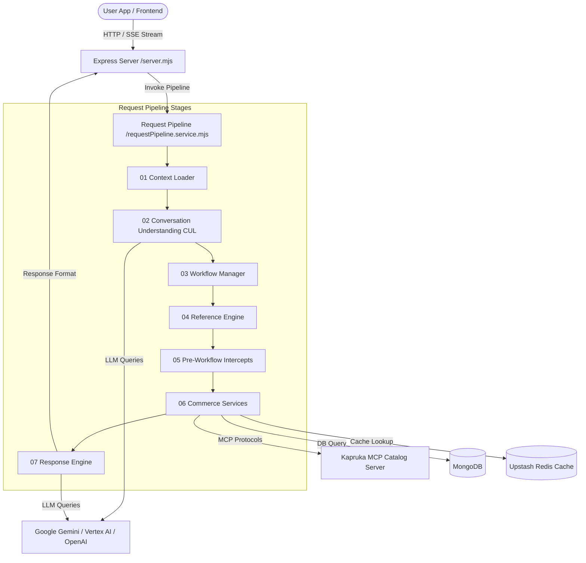

# Velora: Advanced Conversational AI Shopping Assistant for Kapruka

Velora is a premium, context-aware, multilingual conversational AI Shopping Assistant designed specifically for the Kapruka e-commerce platform. Built with a modular **Prompt-based Operating System (Prompt OS)** on top of Express and React, Velora leverages Model Context Protocol (MCP), Upstash Redis, MongoDB, and Gemini/OpenAI LLMs to offer a natural, interactive shopping experience. 

---
Demo Video : https://drive.google.com/file/d/1Yv_aZXqZv2L50LALfHK6NYD9sxVJM8Xw/view?usp=drive_link
## 🚀 Key Features

### 🎙️ Continuous Voice Conversation Mode
Velora features a state-of-the-art continuous voice interface that behaves similarly to ChatGPT Voice Mode, removing the need to press the microphone button for every turn.
* **Audio-Reactive Waveform Animations**: Dynamic visuals indicating whether Velora is `Listening`, `Processing`, `Speaking`, or `Ready`.
* **Silence & End-of-Speech Detection**: Automatically pauses recording when the user stops speaking.
* **Smart Voice State Loop**: Transitions smoothly through `IDLE ➔ LISTENING ➔ PROCESSING ➔ SPEAKING ➔ LISTENING` with customizable delays.
* **Interrupt Handling**: Allows users to interrupt Velora mid-speech by clicking or speaking, instantly clearing the Text-to-Speech (TTS) queue and returning to listening mode.

### 🧠 Intelligent Conversational Pipeline (Prompt OS)
Rather than passing raw chat history directly to an LLM, Velora processes messages through a structured, middleware-inspired 7-stage request pipeline:
1. **Context Loader**: Retrieves session states, active delivery parameters, pending order states, and memory summaries.
2. **Conversation Understanding (CUL)**: Analyzes user intent, sentiment, language, and extracts crucial e-commerce entities (cities, recipients, occasions).
3. **Workflow Manager**: Manages multi-turn conversation states (e.g., transition from browsing to address entry).
4. **Reference Resolution Engine**: Tracks what product cards are currently displayed in the user interface and maps relative commands (e.g., "add the second one to my cart") to actual product database IDs.
5. **Pre-Workflow Interceptions**: Resolves edge-cases and performs validation checks before engaging backend services.
6. **Commerce Services**: Queries the live Kapruka product catalog, updates carts, checks delivery options, and builds order summaries.
7. **Response Engine**: Combines system prompts, response templates, and live data to render short conversational responses while sending structured data to render UI cards on the frontend.

### 🌐 Multilingual Conversational Engine
* Supports queries in **English**, **Sinhala**, **Tamil**, and colloquial **Tanglish** (mixing Sinhala/English or Tamil/English).
* Real-time language identification ensures responses match the user's input language.

### 🎯 Proactive Context Recovery & Fallbacks
* **Accessory & Component Filter**: Intelligently ignores non-matching product search results (e.g., filters out phone cases, screen protectors, or chargers when a user explicitly searches for "smartphones" or "mobiles").
* **Emotional/Situational Mapping**: Converts broad, vague, or emotional requests into product search criteria (e.g., mapping "I am visiting a sick friend in the hospital" to "fruits", "I forgot my wife's birthday" to "cakes", or "I want to say sorry" to "flowers").

### ⚡ SSE Real-Time Streaming
* Live stream capability using Server-Sent Events (SSE) for ultra-fast, word-by-word response loading.

### 🛠️ Diagnostics Health Wizard
* Executes diagnostic sanity checks on startup, ensuring that the MongoDB, Redis Cache, Gemini LLM service, Kapruka MCP server, and Speech/Voice credentials are ready before booting the server.

---

## 📐 Architecture Overview

Velora uses a modern decoupled architecture where the client UI and the AI agent core communicate over a REST/SSE API.



---

## 💻 Tech Stack

### Backend (Agent Core)
* **Runtime**: Node.js (ES Modules)
* **Framework**: Express.js (v5.x)
* **Database**: MongoDB (with Mongoose ORM)
* **Cache**: Upstash Redis (with built-in local Memory Cache fallback)
* **AI Models**: Google Gemini Developer API (Vertex AI SDK / `@google/genai`), OpenAI API SDK
* **Protocols**: Model Context Protocol (MCP) SDK
* **Speech/Voice Services**: Google Cloud Speech-to-Text, ElevenLabs TTS (Text-to-Speech)
* **Development Utilities**: Nodemon, Winston logger, Cli-table3, Chalk, Ora

### Frontend (User Interface)
* **Framework**: React 18 with TypeScript
* **Build System**: Vite
* **Styling**: Tailwind CSS (v4)
* **Animations**: Framer Motion (Motion), Canvas Confetti, Embla Carousel
* **UI Components**: Radix UI Primitives, Material UI (MUI Materials & Icons)
* **Data Visualizations**: Recharts

---

## 📂 Project Structure

```
├── docker-compose.yml              # Multi-container local orchestration
├── frontend/                       # React frontend source
│   ├── src/
│   │   ├── app/
│   │   │   ├── components/         # Chat area, voice dashboard, cart screen, etc.
│   │   │   ├── contexts/           # Global states (e.g. Chat, Voice, Cart)
│   │   │   ├── hooks/              # Custom React hooks
│   │   │   └── services/           # Api client integrations
│   │   └── main.tsx
│   ├── package.json
│   ├── nginx.conf                  # Static asset & API reverse-proxy configuration
│   └── vite.config.ts
└── kapruka-ai-agent/               # Node.js backend agent core
    ├── src/
    │   ├── agent/                  # Prompt templates, router, core prompt cache
    │   ├── ai/                     # LLM service integrations & routers
    │   ├── cache/                  # Redis & Memory cache wrappers
    │   ├── config/                 # Intents configurations
    │   ├── controllers/            # Express controllers
    │   ├── database/               # Mongoose connections and schemas
    │   ├── middleware/             # Rate-limiters, logger middlewares
    │   ├── routes/                 # Express route handlers
    │   ├── services/               # Request pipeline service & commerce connectors
    │   ├── test/                   # Scenario and voice integration tests
    │   └── server.mjs              # Main server entrypoint
    ├── .env.example                # Template for server configuration
    └── Dockerfile                  # Container instructions
```

---

## ⚙️ Installation & Configuration

### Prerequisites
* **Node.js** (v18+ recommended)
* **MongoDB** (Local instance or Atlas cloud cluster)
* **Redis** (Optional: Upstash Redis connection string)
* **Google Cloud Project / API Key** (Required for Gemini vertex/Generative AI)

---

### Method 1: Running with Docker Compose (Recommended)

To build and run both the Frontend and the Backend services concurrently using Docker Compose:

1. In the `kapruka-ai-agent` directory, copy `.env.example` to `.env` and fill in the required LLM API keys:
   ```bash
   cp kapruka-ai-agent/.env.example kapruka-ai-agent/.env
   ```
2. Build and start the services from the workspace root:
   ```bash
   docker-compose up --build
   ```
3. The frontend is accessible at **`http://localhost:3000`** and the backend API is served on **`http://localhost:5000`**.

---

### Method 2: Manual Development Setup

#### 1. Backend Setup
1. Navigate to the backend folder:
   ```bash
   cd kapruka-ai-agent
   ```
2. Install dependencies:
   ```bash
   npm install
   ```
3. Create your `.env` configuration file:
   ```bash
   cp .env.example .env
   ```
4. Update the variables inside `.env`:
   * `PORT`: Server port (default `5000`)
   * `MONGODB_URI`: MongoDB connection string
   * `REDIS_URL`: Redis server URL
   * `GOOGLE_CLOUD_PROJECT`/`GOOGLE_CLOUD_LOCATION`: GCP Credentials
   * `ELEVENLABS_API_KEY`: ElevenLabs Text-to-Speech API key for custom voices

5. Launch the backend in development mode:
   ```bash
   npm run dev
   ```

#### 2. Frontend Setup
1. Open a new terminal and navigate to the frontend folder:
   ```bash
   cd frontend
   ```
2. Install dependencies:
   ```bash
   npm install
   ```
3. Verify that `frontend/.env.development` points to your backend instance:
   ```env
   VITE_API_URL=http://localhost:5000
   ```
4. Start the Vite development server:
   ```bash
   npm run dev
   ```
5. Open your browser and navigate to the output URL (typically `http://localhost:5173`).

---

## 🔍 Diagnostics & Troubleshooting

On backend startup, Velora runs modular health checks and displays a **Prompt Operating System Diagnostics console** outputting status rows:

> [!NOTE]
> If a warning occurs (e.g., `Redis cache offline` or `ElevenLabs key missing`), the server will automatically default to local memory caching and standard Web Speech Synthesis API fallback.

To manually run test cases or query the database schema:
```bash
# Verify the speech/voice setup
npm run test:voice

# Test integration flows
node src/test/test-compare-integration.mjs
```

---

## 📜 License
This project is licensed under the ISC License. See the respective `package.json` files for dependency copyright details.
